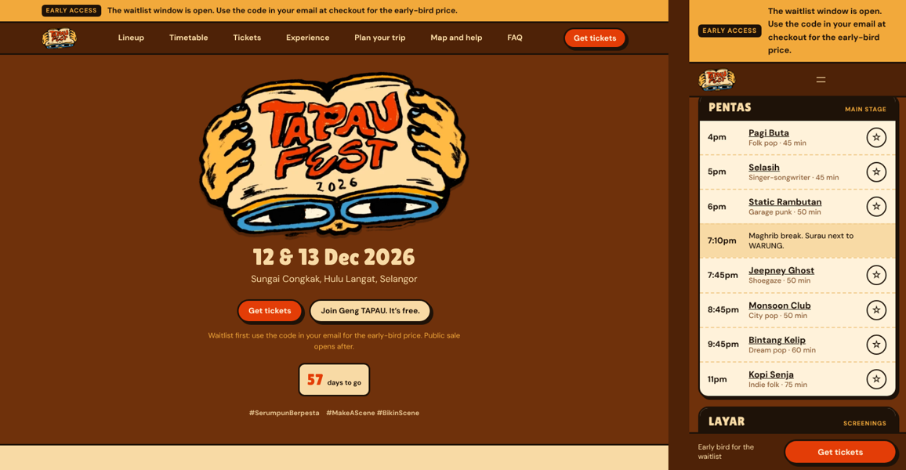

# tapaufest.asia

WordPress build for **TAPAUfest 2026**, 12 and 13 Dec 2026 at Sungai Congkak, Selangor.

Two pieces, both in `wp-content/`:

| Folder | What it is |
| --- | --- |
| `themes/tapaufest-2026` | Block theme. The look from the 2026 logo (kopi brown, cili red, paper cream, thick ink outlines), templates, header and footer, and a pattern for every page. |
| `plugins/tapaufest-core` | Festival content and blocks: artists, set times, ticket tiers, FAQs, vendors, the site state switch, Jadual Aku and calendar export. |

The theme needs the plugin. No build step: plain PHP, CSS and JavaScript.



**[▶ Open a live preview](https://playground.wordpress.net/?blueprint-url=https://raw.githubusercontent.com/wanshariff/tapaufest26/main/blueprint.json)**: a fresh WordPress in your browser with the theme, plugin and mock content, logged in as admin. It takes about 30 seconds to load. Changes vanish when you close the tab. Switch site states in WP Admin > Settings > TAPAUfest.

## Install on tapaufest.asia

Needs WordPress 6.6 or later and PHP 7.4 or later.

1. Copy `wp-content/themes/tapaufest-2026` and `wp-content/plugins/tapaufest-core` into the site’s `wp-content` folder (SFTP or the host’s file manager).
2. Activate **TAPAUfest Core** under Plugins, then **TAPAUfest 2026** under Appearance > Themes.
3. Settings > Permalinks: choose **Post name**.
4. Settings > TAPAUfest: check the dates, venue and links, and pick the site state.
5. To review with mock content: Settings > TAPAUfest > **Load demo content**. It creates the pages, 16 mock artists, 33 set times, 4 tiers, FAQs and vendors. **Remove demo content** deletes all of it.

Pages the theme expects (the demo loader creates them, using the "Festival page" template):
`/tickets/`, `/timetable/`, `/experience/`, `/plan/`, `/map/`, `/faq/`, `/recap/`, `/archive/`. The lineup lives at `/lineup/` and each artist at `/artist/<name>/`.

> The current tapaufest.asia is an Elementor site with the waitlist form. Install this on staging first, and keep exporting waitlist sign-ups from Elementor > Submissions until the switch.

## Running the festival

**Site state** (Settings > TAPAUfest, also shown in the admin bar):

| State | Hero | Header button | Ticket cards |
| --- | --- | --- | --- |
| Early access | Dates, venue, countdown | Get tickets | Early-bird price, “Buy with your code” |
| Public sale | Same | Get tickets | Regular price |
| Festival day | Now / Next per stage | Map and help | Sales closed |
| Recap | Recap and survey buttons | See the recap | Next-edition waitlist |

**Alert bar**: leave the text blank for the default message per state. On festival days, type set changes and weather updates there; they show on every page.

**Early access**: the site never checks or shows the waitlist code. Buyers enter the code from their email at TAPAUtix checkout, so it can’t leak from the site.

**Content** lives under the TAPAUfest menu in wp-admin:

- **Lineup** (artists): name, bio, photo (featured image), country, genre, headliner, listen link (Bandcamp or YouTube, plays in a sheet), tapau.asia profile.
- **Set times**: day, start (24-hour, past midnight keep counting: 00:30 is 24:30), length, stage, type, artist. Stages are set in Settings > TAPAUfest.
- **Ticket tiers**: who it’s for, people, days, early-bird and regular price, what’s included, campsite, TAPAUtix link, sold out.
- **FAQs** grouped by FAQ group, and **Vendors** for WARUNG and PASAR.

## Blocks

All under the TAPAUfest category in the editor, rendered on the server so the editor preview matches the site.

| Block | Where |
| --- | --- |
| Alert bar, Header button, Mobile ticket bar | Header and footer |
| Festival hero | Home |
| Lineup | Home (6 cards) and `/lineup/` (filters, poster view) |
| Artist set details | Artist pages |
| Timetable | `/timetable/`: stage lists per day, Jadual Aku, clash warnings, add to calendar, share link |
| Now and next | Hero in festival-day state, `/map/` |
| Ticket tiers | Home, `/tickets/` (with comparison table) |
| Vendors, FAQ | `/experience/`, `/faq/` |

Jadual Aku picks stay in the visitor’s browser. **Add to calendar** downloads an `.ics` file from `/wp-json/tapaufest/v1/ics?ids=…`. **Share with your geng** makes a `/timetable/?jadual=…` link that offers to add the same picks.

## WP-CLI

```bash
wp tapaufest seed            # load demo content
wp tapaufest unseed          # remove it
wp tapaufest state live      # early | public | live | recap
```

## Local development

With [wp-env](https://developer.wordpress.org/block-editor/reference-guides/packages/packages-env/) and Docker:

```bash
npx @wordpress/env start     # http://localhost:8888, admin / password
npx @wordpress/env run cli wp rewrite structure '/%postname%/'
npx @wordpress/env run cli wp tapaufest seed
```

## Still to confirm

Marked **TBC** on the site: exact site address, drive time and parking, Grab drop-off, nearby campsites and stays, rain and cancellation policy, survey, takedown and WhatsApp links. The draft site map in the theme is a placeholder until production sends the real one.
